# LAPORAN PRAKTIKUM 5 PEMROGRAMAN WEB

Nama : Rizky Opras Fernanda 
NIM : 312510101 
Kelas : I252A 
Program Studi : Teknik Informatika 
Mata Kuliah : Pemrograman Web

## Langkah-Langkah Praktikum

### Persiapan Visual Studio Code dan Browser

Pertama, membuka aplikasi Visual Studio Code sebagai text editor dan browser untuk melihat hasil dari halaman HTML.

Kemudian dibuat folder kerja dengan nama Lab5Web.

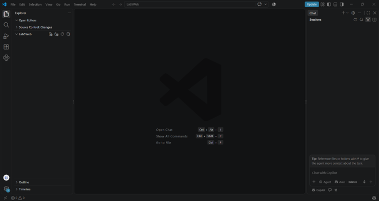

### Membuat Dokumen HTML

Pertama buat index.html dan script.js.

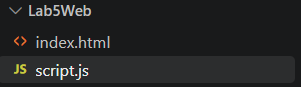

Selanjutnya membuat halaman awal untuk html.

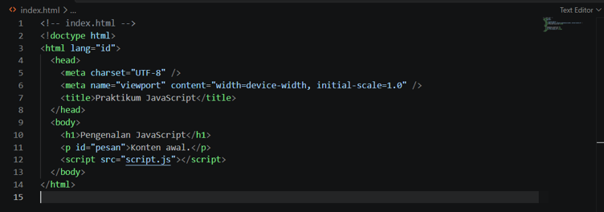

Selanjutnya save file index.html.

Hasilnya :

Muncul heading Pengenalan JavaScript.

### 1. Menampilkan output

Pada tahap ini ditambahkan console log pada file script.js.

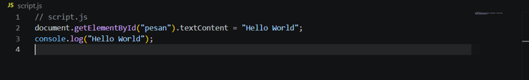

Hasilnya :

Teks dengan tulisan Konten awal. berubah menjadi Hello World.

### 2. Alert dan prompt

Membuat alert dengan menambahkan fungsi java script.

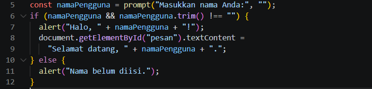

Hasilnya.

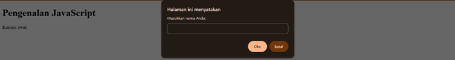

Muncul dialog box untuk memasukan nama, dan jika dimasukan maka hasilnya.

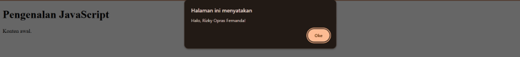

Muncul kalimat Halo, Rizky Opras Fernanda! (Nama yang diinputkan pada dialog box).

Dan jika di OK maka paragaraf pada body berubah menjadi nama yang di inputkan.

### 3. Function dan operasi aritmatika

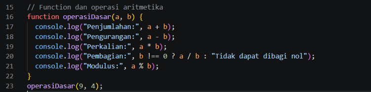

Hasilnya :

Dibuka di console log, dengan cara klik kanan inspect element lalu pilih console.

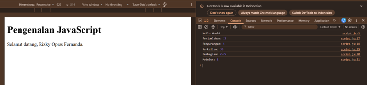

Fungsi console log berfungsi untuk menampilkan informasi atau hasil program di Console browser. Biasanya digunakan untuk melihat hasil perhitungan dan membantu mencari kesalahan (debugging) pada kode.

### 4. Seleksi kondisi if-else

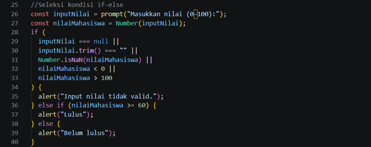

Hasilnya :

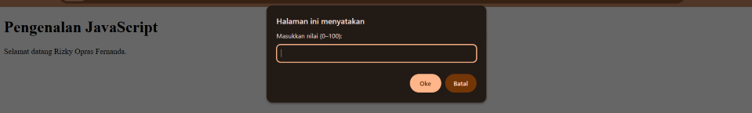
Muncul dialog box untuk memasukan nilai, jika nilai dimasukan nilainya maka, akan muncul kondisi lulus atau tidak lulus.

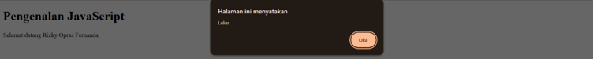

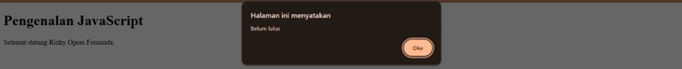

### 5. Seleksi kondisi switch

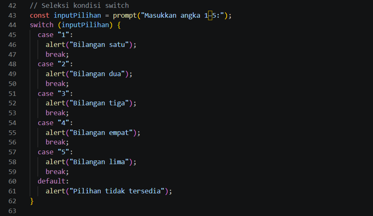

Hasilnya :

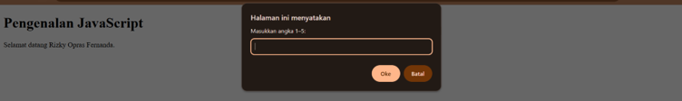

Muncul dialog box untuk memasukan angka 1 – 5 dan jika diisikan hasilnya :

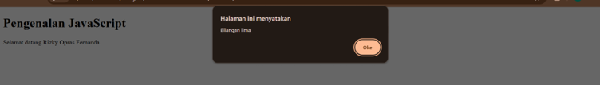

Akan muncul nama bilangan yang diinputkan, dan jika selain 1 sampai 5 akan muncul allert pilihan tidak tersedia.

### 6. Form bilangan genap atau ganjil

Tambahkan kode pada index.html.

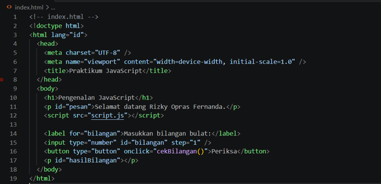

Kemudian pada script.js tambahkan kode :

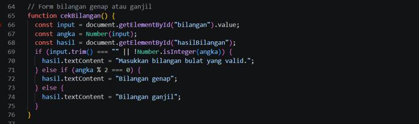

Hasilnyamuncul input untuk memasukan bilangan dan tombol untuk memeriksanya.

Jika dimasukan hasilnya muncul jenis bilangan yang dimasukan.

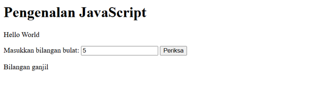

Jika memasukan bilangan negative maka munculnya ganjil genapnya dari bilangan yang di input.

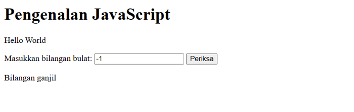

Dan jika dimasukan bilangan decimal hasilnya muncul allert untuk memasukan bilangan bulat yang valid.

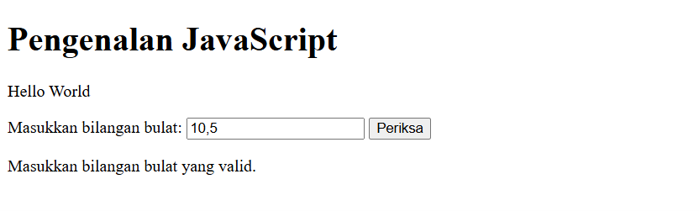

### 7. Mengubah warna halaman

Buat button pada halaman index.html.

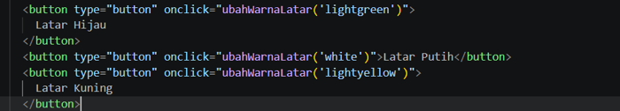

Tambahkan javascriptnya.

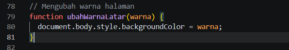

Hasilnya muncul 3 button untuk mengubah warna latar belakang jika di tekan warna background akan menyesuaikan warna pada setia tombolnya.

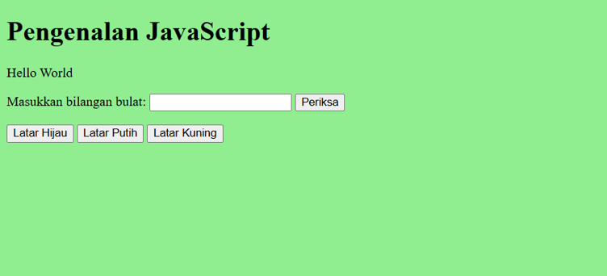

### 8. DOM dan checkbox menu makanan

Tambahkan kode pada file index.html.

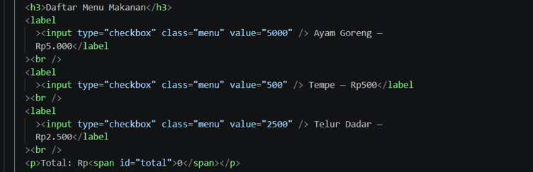

Masukan Javascriptnya.

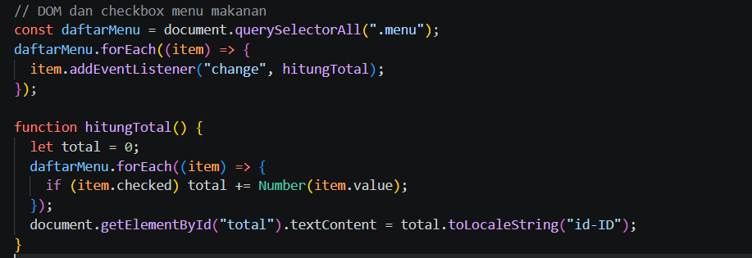

Hasilnya muncul sebuah daftar menu yang jika di checklist akan mengubah total nominal dari item yang di centang pada checkbox.

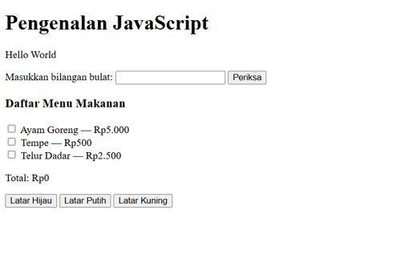

## MINI PROJECT – CALCULATOR MAHASISWA

### 1. Buat kalkulator.html

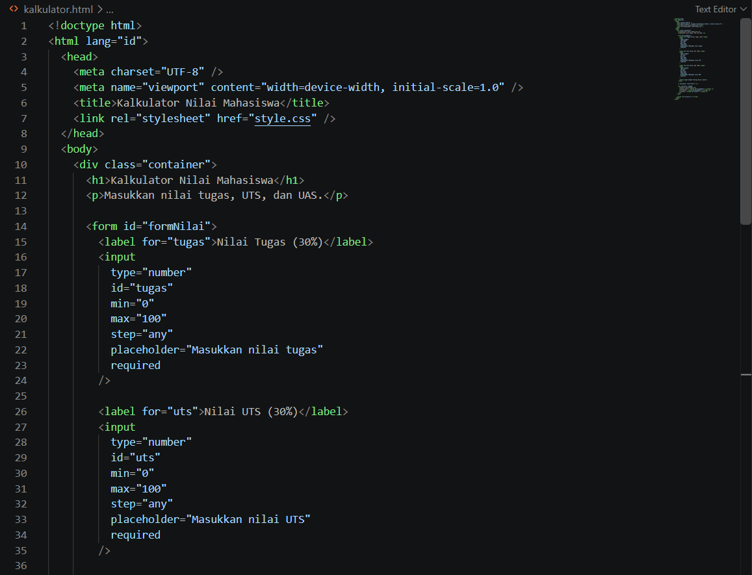

### 2. Tambahkan java scriptnya :

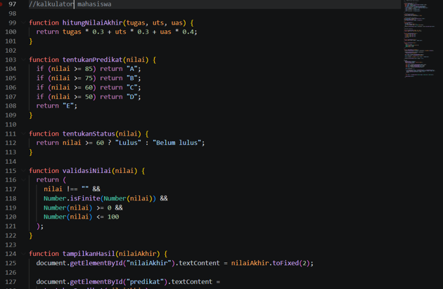

Hasilnya :
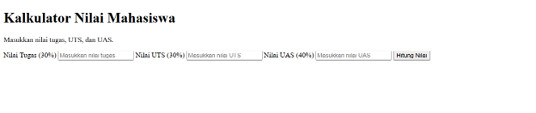

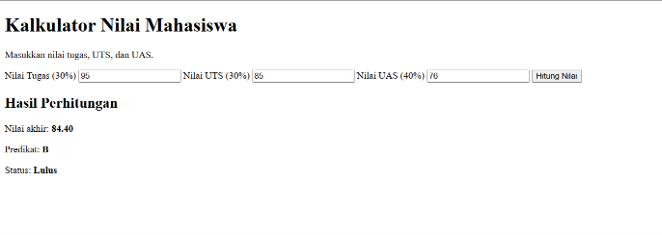

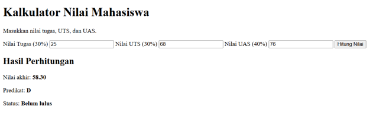

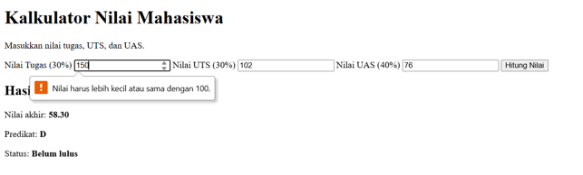

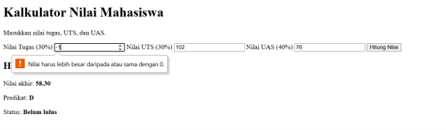

## EXPERIMENT MANDIRI

### 1. Ubah Latihan 3 agar menerima dua nilai dari prompt dan mengonversinya menjadi number.

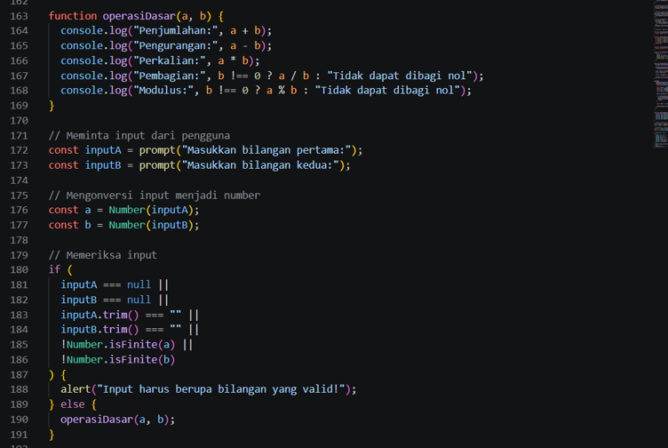

Hasilnya :

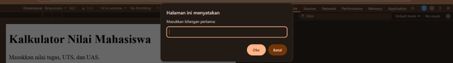

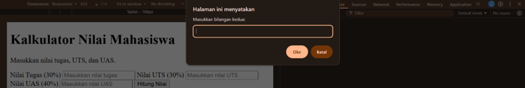

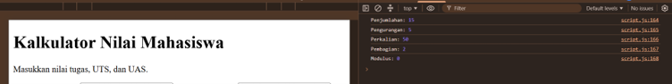

### 7. Buat perulangan untuk menampilkan tabel perkalian angka 7 dari 1 sampai 10.

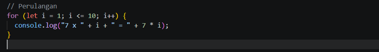

Hasilnya :

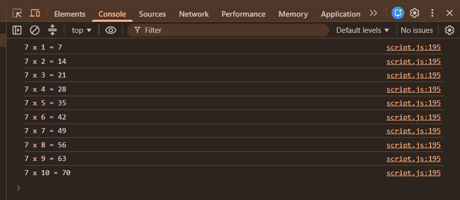

### 8. Buat function cekGenap(angka) yang mengembalikan true jika angka genap.

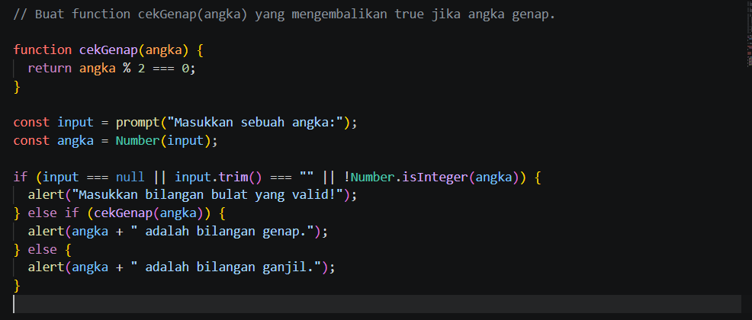

Hasilnya :

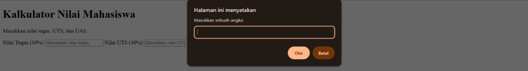

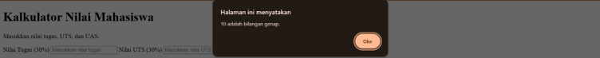

### 9. Tambahkan validasi form agar kolom tidak boleh kosong.

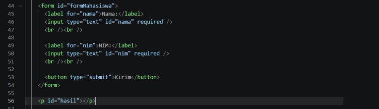

Js

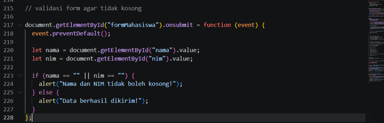

Hasilnya :

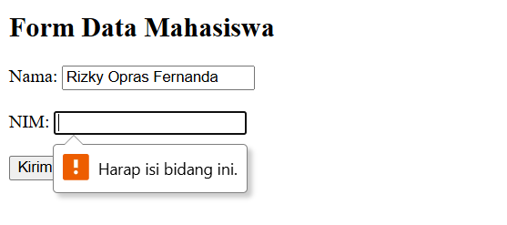

### 11. Gunakan tombol untuk menyembunyikan atau menampilkan elemen HTML.

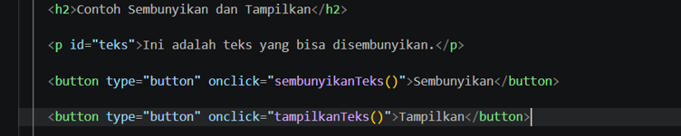

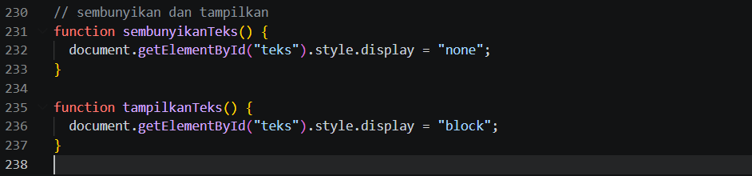

Hasilnya :

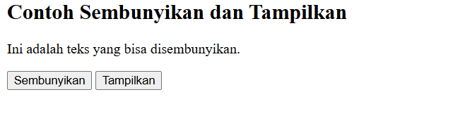

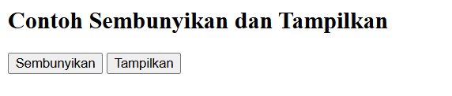

## Pertanyaan dan Tugas

### 1. Jelaskan perbedaan console.log(), alert(), prompt(), dan textContent/innerHTML.

console.log() digunakan untuk menampilkan informasi atau hasil kode di Console browser untuk keperluan pengecekan, alert() digunakan untuk menampilkan pesan dalam kotak dialog kepada pengguna, prompt() digunakan untuk meminta pengguna memasukkan data melalui kotak input, textContent digunakan untuk mengubah isi teks pada elemen HTML tanpa memproses tag HTML, sedangkan innerHTML digunakan untuk mengubah isi elemen HTML dan memproses tag HTML seperti <b> atau 
.

### 2. Apa perbedaan let dan const? Berikan contoh.

let dan const digunakan untuk mendeklarasikan variabel dalam JavaScript, tetapi perbedaannya terletak pada apakah nilai variabel dapat diubah atau tidak.

- let: Digunakan untuk variabel yang nilainya bisa diubah.
- const: Digunakan untuk variabel yang tidak bisa diberi nilai baru setelah dideklarasikan.

Contoh:

### 3. Apa perbedaan operator == dan === ?

Operator == membandingkan dua nilai tanpa memperhatikan tipe datanya, sedangkan operator === membandingkan nilai sekaligus tipe datanya.

### 4. Jelaskan fungsi if–else dan switch. Kapan masing-masing dapat digunakan?

if–else digunakan untuk menjalankan kode berdasarkan kondisi yang benar atau salah, sedangkan switch digunakan untuk memilih salah satu dari beberapa kemungkinan nilai yang tersedia.

Kapan digunakan?

- if–else: Saat memeriksa kondisi, rentang angka, atau beberapa syarat, seperti menentukan kelulusan berdasarkan nilai.
- switch: Saat memilih tindakan berdasarkan nilai tertentu, seperti menentukan nama hari berdasarkan nomor hari.

### 5. Apa fungsi parameter dan return dalam function?

Parameter berfungsi untuk menerima data atau nilai yang dikirimkan ke dalam function, sedangkan return berfungsi untuk mengembalikan hasil dari function agar dapat digunakan kembali.

### 6. Bagaimana JavaScript memilih elemen HTML menggunakan document.getElementById()?

JavaScript menggunakan document.getElementById() untuk memilih elemen HTML berdasarkan atribut id yang unik, sehingga elemen tersebut dapat diakses atau diubah melalui JavaScript.

### 7. Buat script untuk memvalidasi form agar nama tidak kosong dan nilai berada pada rentang 0–100.

